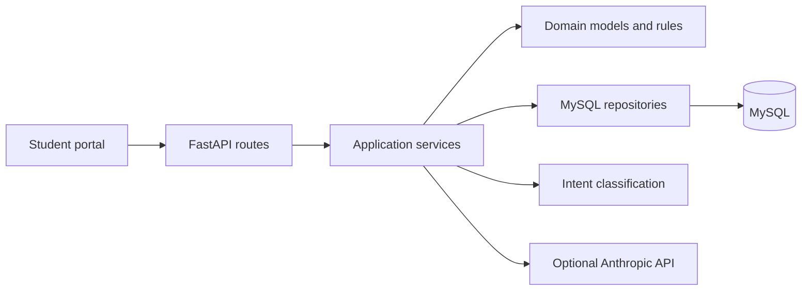

# UniBot · academic assistant

[](https://github.com/LercZin/unibot/actions/workflows/tests.yml)

A collaborative university project combining academic information, institutional FAQs and an optional AI assistant in a browser-based student portal.

Built for Object-Oriented Programming II / Chatbot coursework at Anhanguera. This is an **academic prototype**, not an official university service.

[Português: original guide](docs/README.pt-BR.md) · [Architecture](docs/architecture.md) · [Development guide](CONTRIBUTING.md)

## What the project demonstrates

- Python domain models for students, professors, administrators and academic records.
- FastAPI endpoints with JWT authentication, validation and MySQL persistence.
- Rule-based intent classification and database-backed FAQ responses.
- Optional Anthropic integration for generated responses.
- A student portal using HTML, CSS, JavaScript and Bootstrap.
- Unit tests for domain behavior, grade calculations, intent detection and chatbot routing.

## Architecture



The chatbot handles supported queries and FAQs using application data, and delegates to the configured provider when its routing logic calls for a generated answer. An n8n workflow is included as an optional integration artifact.

## Stack

Python 3.11+ · FastAPI · Pydantic · MySQL 8 · bcrypt · JWT · Anthropic SDK · pytest · HTML/CSS/JavaScript · Bootstrap

## Run locally

Use a disposable development environment. **`database/schema.sql` drops and recreates the `unibot` database. Never run it against an existing or production database.**

1. Copy `.env.example` to `.env` in the repository root. Set your local database values and replace `JWT_SECRET` with a random secret. Example values are for demonstration only.
2. Create the local schema and load the demonstration seeds using a MySQL client: `database/schema.sql`, then `database/seed.sql`, then `database/faq_seed.sql`.
3. Create and activate a Python virtual environment, install the backend dependencies and start the API.

```bash
python -m venv .venv
# Windows PowerShell: .venv\Scripts\Activate.ps1
# macOS/Linux: source .venv/bin/activate
python -m pip install -r backend/requirements.txt
cd backend
python -m uvicorn app.main:app --reload --host 127.0.0.1 --port 8000
```

API: `http://localhost:8000` · API documentation: `http://localhost:8000/docs`.

In a second terminal, from the repository root:

```bash
python -m http.server 8080 --bind 127.0.0.1 --directory frontend
```

Open `http://localhost:8080`. The frontend calls the local API on port 8000. Seed accounts and their demonstration password are documented in `database/seed.sql`; do not reuse them outside the local demo.

Generate a JWT secret with `python -c "import secrets; print(secrets.token_urlsafe(48))"`. Live AI calls require a real `ANTHROPIC_API_KEY`; the example key is a placeholder. Unit tests mock external services and need no real provider key.

## Tests

With the dependencies installed, run from the repository root:

```bash
python -m pytest backend/tests -q
node --test frontend/tests/*.test.cjs
```

**Verified locally on November 1, 2026: 75 Python tests and 11 JavaScript tests passed.** JavaScript tests use Node.js 22+ and its built-in test runner with browser doubles; no npm dependencies are needed. The Python suite includes HTTP/repository authorization tests using isolated in-memory storage and test authentication. CI runs both suites on pushes and pull requests. These checks do not certify live MySQL, provider or browser integration.

## Repository map

| Path | Responsibility |
| --- | --- |
| `backend/app/domain/` | Domain objects and business rules |
| `backend/app/routers/` | HTTP endpoints |
| `backend/app/services/` | Authentication, chatbot routing and AI integration |
| `backend/app/db/` | MySQL access and repositories |
| `backend/tests/` | Unit tests |
| `database/` | Local schema and demonstration seeds |
| `frontend/` | Browser interface |
| `n8n/workflows/` | Optional workflow export |

## Known limitations

- Password recovery is a demonstration; it does not send a reset email.
- Some interface flows contain shortcuts for seeded demonstration users.
- Live-provider calls, database integration and full browser journeys need separate testing.
- Docker Compose is a development aid. Review exposed ports, secrets, authentication and service readiness before deployment.
- No project-wide license is currently supplied. Public visibility alone does not grant an open-source license.

The frontend regression suite verifies separate chat/academic-history endpoints, token-storage transitions, expired-session behavior and truthful recovery messaging without inserting user markup into HTML. It also loads the actual API client and widget together to verify chat-history rendering. See the [authorization review](docs/chat-authorization.md) for the protected chat boundary and test scope.

## Contributors

**Lucas's implementation contribution:** backend, frontend, database schema and chatbot implementation.

**Academic project team:**

- Lucas Emanuel Ramos Carvalho
- Pedro Henrick Silva de Oliveira
- Danilo da Silva Portela

The November 2026 maintenance changes add conversation ownership enforcement, bounded history queries, stable message ordering, and widget/client regression coverage. They are recorded separately in Git history from the original academic implementation.
